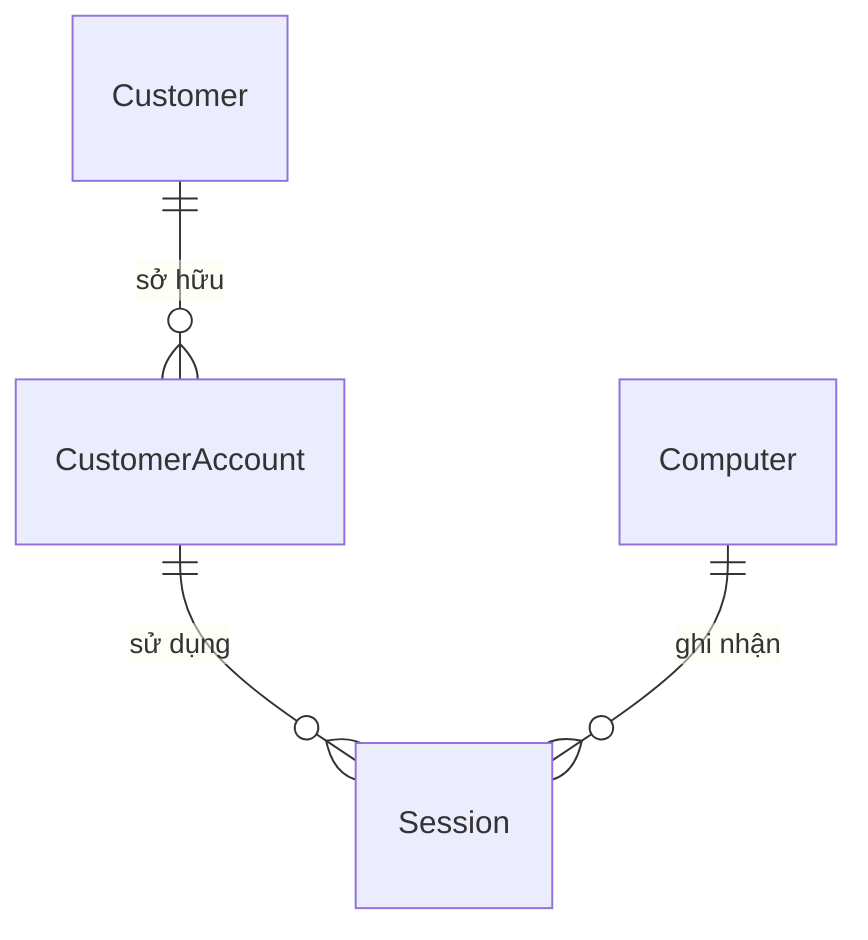
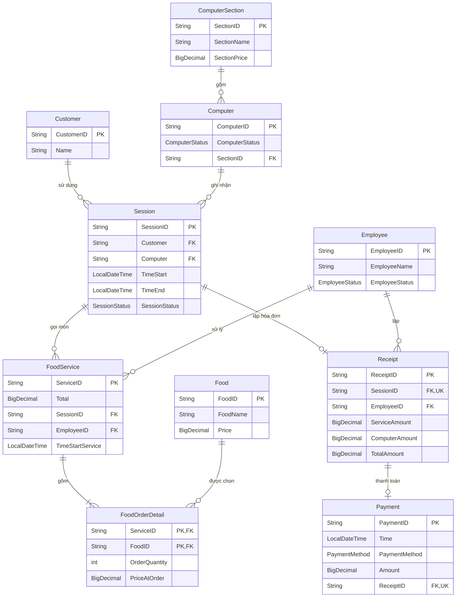

# ĐẶC TẢ DỰ ÁN MIS QUẢN LÝ QUÁN NET

**Môn học:** Lập trình hướng đối tượng — **Ngôn ngữ:** Java — **IDE:** IntelliJ IDEA  
**Nhóm:** Cậu Chủ nhỏ

| Thành viên | Phạm vi phụ trách |
|---|---|
| 1 | Khu máy, máy tính, phiên sử dụng |
| 2 | Khách hàng, nhân viên, dịch vụ ăn uống |
| 3 | Hóa đơn, thanh toán, thống kê |

## Bổ sung tài khoản khách hàng trong mã hiện tại

Phần đặc tả gốc bên dưới được giữ làm tài liệu ban đầu. Mã đã mở rộng quan hệ khách–phiên thành **Customer → CustomerAccount → Session** theo yêu cầu bổ sung tài khoản:

- CustomerAccount: accountId, username, passwordHash, balance, status, customer. Chủ tài khoản đã đăng ký; mã và username không trùng; username không phân biệt hoa/thường; số dư không âm.
- Customer vẫn giữ mã/tên, Normal/Member/VIP và IDiscount.
- Session giữ account thay cho customer; lấy khách qua account.getCustomer().
- Session có plannedEndTime tùy chọn cho giờ kết thúc dự kiến; timeEnd lưu giờ kết thúc thực tế. Khách có thể nghỉ sớm hoặc chơi quá giờ; tiền và thanh toán dùng timeEnd, không dùng plannedEndTime. Giờ dự kiến không tự đóng phiên.
- NetCafeData có accounts; CatalogService có addAccount.
- Mở phiên yêu cầu tài khoản đã đăng ký, ACTIVE, chưa có phiên ACTIVE và không chồng lấn lịch sử tài khoản/máy.
- ReceiptService lấy ưu đãi qua session.getAccount().getCustomer().
- Chưa triển khai đăng nhập/xác thực, nạp/trừ tiền hoặc ràng buộc số tài khoản trên một khách.

## 1. Phát biểu vấn đề, thực thể, thuộc tính, liên kết và ERD

### 1.1. Phát biểu vấn đề

Quán net cần quản lý máy theo từng khu có giá giờ khác nhau; ghi nhận khách sử dụng máy, thời gian chơi và các món ăn, đồ uống đã gọi. Khi khách kết thúc phiên, nhân viên lập hóa đơn gồm tiền máy và tiền dịch vụ. Hệ thống ghi nhận thanh toán, hỗ trợ tra cứu lịch sử và thống kê doanh thu.

Quy trình: **chọn khách và máy trống → mở phiên → ghi nhận gọi món → kết thúc phiên → lập hóa đơn → thanh toán**. Một phiên dùng một máy; mỗi lần gọi món được ghi thành một `FoodService` với các dòng `FoodOrderDetail`.

Phạm vi: một quán net, quản lý bằng danh sách đối tượng Java; mỗi hóa đơn được thanh toán đủ tiền trong một lần.

### 1.2. Thực thể và thuộc tính

Tên thực thể và thuộc tính giữ theo ảnh ERD. **PK** là khóa chính; **FK** là khóa ngoại; **UNIQUE** bảo đảm không trùng.

| Thực thể | Thuộc tính khóa và liên kết | Thuộc tính mô tả | Ý nghĩa |
|---|---|---|---|
| `ComputerSection` | `SectionID` — PK | `SectionName`, `SectionPrice` | Khu máy và đơn giá theo giờ. |
| `Computer` | `ComputerID` — PK; `SectionID` — FK | `ComputerStatus` | Máy tính thuộc một khu. |
| `Customer` | `CustomerID` — PK | `Name` | Khách sử dụng máy. |
| `Employee` | `EmployeeID` — PK | `EmployeeName`, `EmployeeStatus` | Nhân viên xử lý gọi món và lập hóa đơn. |
| `Session` | `SessionID` — PK; `Customer`, `Computer` — tham chiếu khách và máy | `TimeStart`, `TimeEnd`, `SessionStatus` | Một lần sử dụng máy của khách. |
| `FoodService` | `ServiceID` — PK; `SessionID`, `EmployeeID` — FK | `TimeStartService`, `Total` | Một lần gọi món; `Total` tính từ các dòng chi tiết. |
| `FoodOrderDetail` | (`ServiceID`, `FoodID`) — PK ghép; mỗi thành phần đồng thời là FK | `OrderQuantity`, `PriceAtOrder` | Món, số lượng và giá tại thời điểm gọi. |
| `Food` | `FoodID` — PK | `FoodName`, `Price` | Danh mục món ăn, đồ uống. |
| `Receipt` | `ReceiptID` — PK; `SessionID` — FK, UNIQUE; `EmployeeID` — FK | `ServiceAmount`, `ComputerAmount`, `TotalAmount` | Hóa đơn cho một phiên. |
| `Payment` | `PaymentID` — PK; `ReceiptID` — FK, UNIQUE | `Time`, `PaymentMethod`, `Amount` | Lần thanh toán thành công của hóa đơn. |

`Customer` và `Computer` trong `Session` tương ứng với khóa ngoại `CustomerID` và `ComputerID` khi biểu diễn dữ liệu dạng bảng. Trong một lần gọi món, mỗi món có một dòng; gọi thêm cùng món thì cộng số lượng.

### 1.3. Các mối liên kết

| Liên kết | Bội số | Diễn giải |
|---|---|---|
| ComputerSection — Computer | 1 — 0..n | Một khu có nhiều máy; mỗi máy thuộc đúng một khu. |
| Customer — Session | 1 — 0..n | Một khách có nhiều phiên theo lịch sử; mỗi phiên thuộc một khách. |
| Computer — Session | 1 — 0..n | Một máy có nhiều phiên theo lịch sử; mỗi phiên dùng một máy. |
| Session — FoodService | 1 — 0..n | Một phiên có thể gọi món nhiều lần hoặc không gọi món. |
| Employee — FoodService | 1 — 0..n | Mỗi lần gọi món do một nhân viên xử lý. |
| FoodService — FoodOrderDetail | 1 — 1..n | Một lần gọi món được ghi nhận có ít nhất một dòng chi tiết. |
| Food — FoodOrderDetail | 1 — 0..n | Một món xuất hiện trong nhiều dòng chi tiết; mỗi dòng chọn một món. |
| Session — Receipt | 1 — 0..1 | Một phiên có tối đa một hóa đơn; mỗi hóa đơn thuộc một phiên. |
| Employee — Receipt | 1 — 0..n | Mỗi hóa đơn do một nhân viên lập. |
| Receipt — Payment | 1 — 0..1 | Hóa đơn chưa trả chưa có Payment; đã trả có đúng một Payment. |

Tất cả liên kết trên là **quan hệ hai ngôi**. `FoodOrderDetail` biểu diễn quan hệ nhiều–nhiều giữa `FoodService` và `Food`, đồng thời lưu số lượng và giá gọi món.

### 1.4. ERD

### 1.5. Quy tắc nghiệp vụ và tính tiền (Ràng buộc)

- Mã không rỗng, không trùng trong cùng loại; mọi tham chiếu phải trỏ tới đối tượng tồn tại.
- Chỉ mở phiên trên máy `AVAILABLE`. Một máy và một khách có tối đa một phiên `ACTIVE` tại cùng thời điểm. Mở phiên chuyển máy sang `IN_USE`; kết thúc phiên chuyển máy về `AVAILABLE`.
- Phiên `ACTIVE` có `TimeEnd = null`; phiên `COMPLETED` có `TimeEnd > TimeStart`. Các phiên trên cùng máy không chồng lấn.
- Chỉ ghi nhận gọi món trong phiên đang hoạt động, do nhân viên `ACTIVE` xử lý. Số lượng là số nguyên dương; giá không âm; thời gian gọi nằm trong phiên.
- `PriceAtOrder` được giữ nguyên khi giá món thay đổi. Để giữ đúng tiền máy lịch sử với các thuộc tính trong ERD, bản này cố định `SectionPrice` và khu của máy sau khi khu đã phát sinh phiên.
- Chỉ lập hóa đơn cho phiên đã hoàn tất; chốt tiền máy và tiền dịch vụ, không sửa các dòng món đã ghi nhận. Chưa có `Payment` nghĩa là hóa đơn chưa thanh toán.
- Khi thu đủ tổng hóa đơn, tạo một `Payment`; `Amount = TotalAmount`, `Time ≥ TimeEnd`. Không thanh toán lặp và không xóa đối tượng đang được lịch sử tham chiếu.

| Đại lượng | Công thức |
|---|---|
| Tiền máy | Số giây sử dụng × `SectionPrice` / 3600; làm tròn đến đồng theo `HALF_UP`. |
| Tiền dòng món | `OrderQuantity × PriceAtOrder`. |
| FoodService.Total | Tổng tiền các dòng chi tiết của lần gọi món. |
| Receipt.ServiceAmount | Tổng `FoodService.Total` của phiên. |
| Receipt.TotalAmount | `ComputerAmount + ServiceAmount`. |
| Doanh thu thực thu | Tổng `Payment.Amount`, thống kê thời điểm thu theo `Payment.Time`. |

## 2. Chuyển các quan hệ ERs/RRs thành lớp Java trên IntelliJ

Mỗi thực thể trong ERD tương ứng một lớp Java. Thuộc tính dùng `private`; mã và tên dùng `String`, tiền dùng `BigDecimal`, thời gian dùng `LocalDateTime`, số lượng dùng `int`. Khóa ngoại chuyển thành tham chiếu đối tượng; tên thuộc tính Java dùng camelCase.

| Lớp Java | Thuộc tính chính |
|---|---|
| `ComputerSection` | `sectionId`, `sectionName`, `sectionPrice` |
| `Computer` | `computerId`, `computerStatus: ComputerStatus`, `section: ComputerSection` |
| `Customer` | `customerId`, `name` |
| `Employee` | `employeeId`, `employeeName`, `employeeStatus: EmployeeStatus` |
| `Session` | `sessionId`, `customer: Customer`, `computer: Computer`, `timeStart`, `timeEnd`, `sessionStatus: SessionStatus` |
| `FoodService` | `serviceId`, `session: Session`, `employee: Employee`, `timeStartService`, `details: List<FoodOrderDetail>`; `getTotal()` tính tổng chi tiết |
| `FoodOrderDetail` | `service: FoodService`, `food: Food`, `orderQuantity`, `priceAtOrder` |
| `Food` | `foodId`, `foodName`, `price` |
| `Receipt` | `receiptId`, `session: Session`, `employee: Employee`, `serviceAmount`, `computerAmount`; `getTotalAmount()` tính tổng hai khoản |
| `Payment` | `paymentId`, `receipt: Receipt`, `time`, `paymentMethod: PaymentMethod`, `amount` |

`FoodService.details` chứa các dòng món; mỗi dòng tham chiếu một `Food` trong danh mục. Các quan hệ một–nhiều còn lại được truy xuất bằng cách lọc danh sách theo tham chiếu. Khóa ghép của `FoodOrderDetail` được bảo đảm bằng việc không có hai dòng cùng món trong một `FoodService`.

**Tổ chức project `NetCafeMIS`:** package `netcafe.model` chứa 10 lớp trên; `netcafe.enums` chứa các enum; `netcafe.Main` chứa `main()` để khởi tạo dữ liệu, điều phối mở/kết thúc phiên và ghi nhận thanh toán. Công thức tính tiền đặt trong lớp tương ứng. Dữ liệu được giữ bằng `List<T>`; phần 4 chỉ đặc tả truy vấn, chưa viết code truy vấn.

## 3. Tạo dữ liệu cho thực thể, quan hệ và enum, interface 

### 3.1. Enum

| Enum | Giá trị | Sử dụng |
|---|---|---|
| `ComputerStatus` | `AVAILABLE`, `IN_USE`, `MAINTENANCE` | Máy trống, đang sử dụng, bảo trì. |
| `SessionStatus` | `ACTIVE`, `COMPLETED` | Phiên đang sử dụng, đã hoàn tất. |
| `EmployeeStatus` | `ACTIVE`, `INACTIVE` | Nhân viên đang làm việc, ngừng làm việc. |
| `PaymentMethod` | `CASH`, `BANK_TRANSFER`, `CARD` | Tiền mặt, chuyển khoản, thẻ. |

### 3.2 Interface
#### 3.2.1. Identifiable — hữu ích khi quản lý danh sách
public interface Identifiable {
    String getId();
}
#### 3.2.2. IChargeable — phù hợp nhất với bài
public interface Chargeable {
    BigDecimal calculateAmount();
}

#### 3.2.3. IDiscount
public interface IDiscount{
  double GetDiscount();
}

#### 3.3. Dữ liệu mẫu

Dữ liệu giả lập tại **12:00 ngày 05/10/2026**, giờ Việt Nam. Mọi thời gian dưới đây thuộc ngày này; tiền tính bằng VND. Mã tham chiếu trong bảng được thay bằng đối tượng tương ứng khi khởi tạo Java.

**ComputerSection**

| SectionID | SectionName | SectionPrice |
|---|---|---:|
| CS01 | Khu thường | 12000 |
| CS02 | Khu VIP | 20000 |

**Computer**

| ComputerID | ComputerStatus | SectionID |
|---|---|---|
| PC01 | AVAILABLE | CS01 |
| PC02 | IN_USE | CS01 |
| PC03 | AVAILABLE | CS02 |
| PC04 | AVAILABLE | CS02 |
| PC05 | MAINTENANCE | CS01 |
| PC06 | AVAILABLE | CS02 |

**Customer**

| CustomerID | Name |
|---|---|
| C01 | Lamine Yamal |
| C02 | Bruno Fernades |
| C03 | Cristiano Ronaldo |
| C04 | Lionel Messi |

**Employee**

| EmployeeID | EmployeeName | EmployeeStatus |
|---|---|---|
| E01 | Erik TenHag | ACTIVE |
| E02 | Anchelotti | ACTIVE |
| E03 | Luis Enrique | INACTIVE |

**Session**

| SessionID | Customer | Computer | TimeStart | TimeEnd | SessionStatus |
|---|---|---|---|---|---|
| S01 | C01 | PC01 | 08:00 | 10:00 | COMPLETED |
| S02 | C02 | PC03 | 09:00 | 10:30 | COMPLETED |
| S03 | C03 | PC04 | 10:00 | 11:00 | COMPLETED |
| S04 | C01 | PC02 | 11:00 | null | ACTIVE |

**Food**

| FoodID | FoodName | Price |
|---|---|---:|
| F01 | Mì ly | 13000 |
| F02 | Nước ngọt | 15000 |
| F03 | Snack | 7000 |

**FoodService** — `Total` được tính từ bảng chi tiết bên dưới.

| ServiceID | SessionID | EmployeeID | TimeStartService | Total |
|---|---|---|---|---:|
| SV01 | S01 | E01 | 08:20 | 25000 |
| SV02 | S02 | E02 | 09:30 | 30000 |
| SV03 | S04 | E01 | 11:15 | 20000 |

**FoodOrderDetail** — mỗi cặp (`ServiceID`, `FoodID`) là một khóa ghép duy nhất.

| ServiceID | FoodID | OrderQuantity | PriceAtOrder |
|---|---|---:|---:|
| SV01 | F01 | 1 | 15000 |
| SV01 | F02 | 1 | 10000 |
| SV02 | F01 | 2 | 15000 |
| SV03 | F02 | 2 | 10000 |

**Receipt** — `TotalAmount` là tổng hai khoản tiền.

| ReceiptID | SessionID | EmployeeID | ServiceAmount | ComputerAmount | TotalAmount |
|---|---|---|---:|---:|---:|
| R01 | S01 | E02 | 25000 | 24000 | 49000 |
| R02 | S02 | E01 | 30000 | 30000 | 60000 |

**Payment**

| PaymentID | Time | PaymentMethod | Amount | ReceiptID |
|---|---|---|---:|---|
| P01 | 10:05 | CASH | 49000 | R01 |

### 3.4. Khởi tạo và kiểm tra liên kết

Khởi tạo theo thứ tự: **khu, khách, nhân viên, món → máy → phiên → dịch vụ và chi tiết → hóa đơn → thanh toán**. Khi tạo đối tượng, gán các tham chiếu đến đối tượng đã tồn tại; cập nhật trạng thái máy theo phiên.

Ví dụ: `C01 → S01 → PC01 → CS01`; `S01 → SV01 → {F01, F02}`; `S01 → R01 → P01`. `E01` xử lý `SV01`, `E02` lập `R01`.

Kiểm tra dữ liệu: chỉ `PC02` có phiên đang hoạt động; `R01 = 24000 + 25000 = 49000` đã thanh toán; `R02 = 30000 + 30000 = 60000` chưa thanh toán; `S03` đã kết thúc nhưng chưa có hóa đơn. Tổng hóa đơn **109000 = 49000 đã thu + 60000 chưa thu**. Chi phí phiên `S04` chưa tính vào doanh thu.

## 4. Mỗi thành viên viết 10 câu truy vấn — chưa code

Các câu dưới đây dùng tên và liên kết ở phần 1. Hóa đơn đã trả được xác định qua `Payment`; doanh thu lấy từ `Payment.Amount`. Với thống kê theo ngày, sử dụng từ 00:00 đến trước 00:00 ngày kế tiếp. Tổng hoặc số lượng trên tập rỗng bằng 0; truy vấn giá trị lớn nhất giữ tất cả kết quả đồng hạng.

### 4.1. Thành viên 1 — Khu máy, máy tính, phiên sử dụng

1. Liệt kê máy `AVAILABLE`, kèm tên khu và giá giờ, sắp xếp giá tăng dần.
2. Liệt kê máy `MAINTENANCE`, kèm tên khu.
3. Đếm số máy theo từng trạng thái trong mỗi khu, kể cả khu chưa có máy.
4. Tìm các khu có giá giờ lớn hơn ngưỡng nhập, sắp xếp giá giảm dần.
5. Với mã máy nhập, liệt kê lịch sử phiên, tên khách, thời gian và trạng thái; phiên mới nhất trước.
6. Liệt kê phiên `ACTIVE`, kèm khách, máy, khu và thời gian bắt đầu.
7. Tìm phiên `COMPLETED` có thời lượng ít nhất 120 phút, sắp xếp thời lượng giảm dần.
8. Tính tổng số phút của các phiên `COMPLETED` bắt đầu trong ngày nhập, theo từng máy; máy không có phiên phù hợp hiển thị 0.
9. Tìm máy chưa từng có phiên sử dụng.
10. Tạm tính tiền máy của các phiên `ACTIVE` tại thời điểm nhập; thời điểm này không được trước lúc bắt đầu phiên.

### 4.2. Thành viên 2 — Khách hàng, nhân viên, dịch vụ ăn uống

1. Với mã khách nhập, liệt kê lịch sử phiên, máy và trạng thái; phiên mới nhất trước.
2. Tìm khách chưa từng có phiên sử dụng.
3. Đếm phiên `COMPLETED` của từng khách, kể cả khách có kết quả 0; sắp xếp số phiên giảm dần.
4. Tìm món có giá hiện tại không vượt ngưỡng nhập, sắp xếp giá tăng dần.
5. Với mã phiên nhập, liệt kê các lần gọi món, nhân viên xử lý, món, số lượng, giá lúc gọi và thành tiền.
6. Tính tổng tiền ăn uống của từng phiên, kể cả phiên không gọi món; sắp xếp tổng giảm dần.
7. Tìm phiên `COMPLETED` không phát sinh dịch vụ ăn uống.
8. Tìm món có tổng số lượng được gọi lớn nhất trên các dịch vụ đã ghi nhận, kể cả phiên đang hoạt động.
9. Tìm lần gọi món có `Total` lớn hơn ngưỡng nhập, kèm tên khách của phiên tương ứng.
10. Theo ngày gọi món nhập, thống kê số lần gọi và tổng tiền dịch vụ do từng nhân viên xử lý; người không có dịch vụ hiển thị 0.

### 4.3. Thành viên 3 — Hóa đơn, thanh toán, thống kê

1. Liệt kê hóa đơn chưa có `Payment`, kèm khách, nhân viên lập và tổng tiền.
2. Tính doanh thu thực thu theo từng ngày thanh toán.
3. Thống kê số giao dịch và tổng tiền theo từng `PaymentMethod`; phương thức chưa dùng hiển thị 0.
4. Tìm hóa đơn có tổng tiền lớn nhất, kèm khách và mã phiên.
5. Tìm tối đa 3 khách có tổng tiền thực trả cao nhất; chỉ xét khách đã thanh toán, sắp xếp tổng giảm dần rồi mã khách tăng dần.
6. Theo từng nhân viên lập hóa đơn, đếm hóa đơn và tính tổng giá trị, tách tiền đã thu và chưa thu; người chưa lập hiển thị 0.
7. Tính tổng tiền còn phải thu theo khách; chỉ hiển thị khách có hóa đơn chưa thanh toán.
8. Tính doanh thu thực thu theo khu máy, tách tiền máy và tiền dịch vụ của hóa đơn đã trả; khu chưa có doanh thu hiển thị 0.
9. Phát hiện hóa đơn có nhiều `Payment` hoặc `Payment.Amount` khác `TotalAmount`; trả mã hóa đơn và lý do sai lệch.
10. Tìm phiên `COMPLETED` chưa có hóa đơn.
