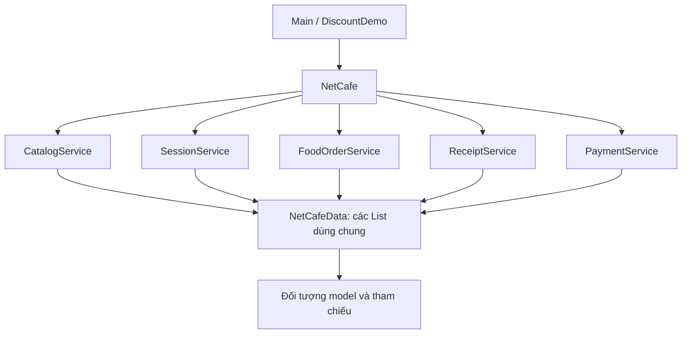
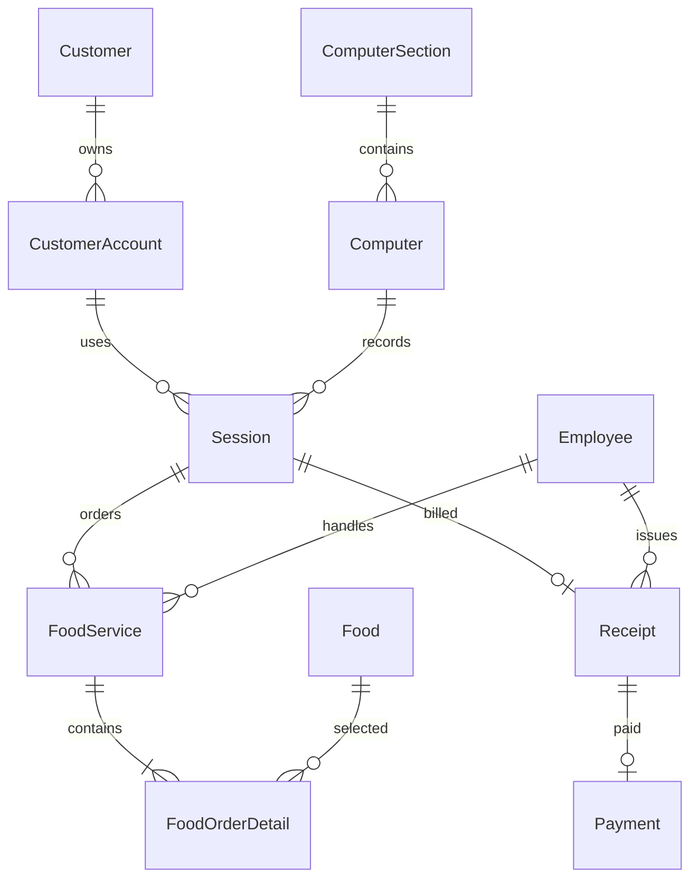
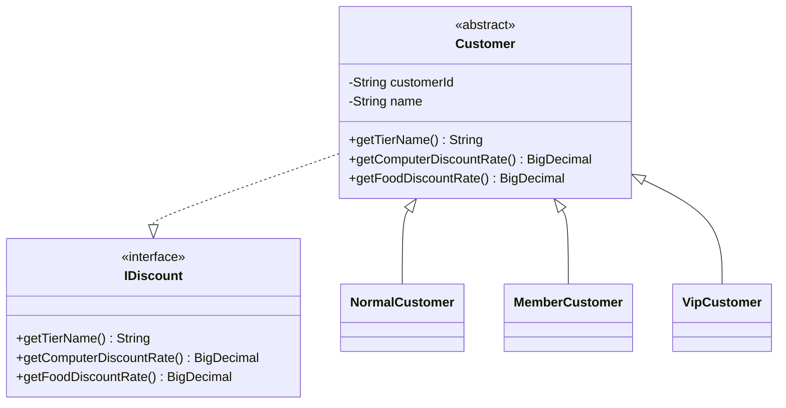

# NetCafeMIS — Tổng quan, giải thích thiết kế và đánh giá dự án học tập

**Project:** `D:\OOP\NetCafeMIS`  
**Nền tảng:** Java 8, Maven, ứng dụng console trên IntelliJ IDEA  
**Thời điểm đối chiếu mã:** 10/10/2026
**Mục đích tài liệu:** giúp đọc code, hiểu nghiệp vụ, chuẩn bị trình bày bài OOP và nhận diện những điểm nên cải thiện.

Tài liệu phản ánh mã hiện tại. Các đề xuất cải thiện ở cuối tài liệu là nhận xét thiết kế, chưa phải các chức năng đã được triển khai.

## 1. Tổng quan dự án

NetCafeMIS mô phỏng việc quản lý một quán net: đăng ký khu máy và danh mục, mở phiên cho khách, ghi nhận món đã gọi, kết thúc phiên, lập hóa đơn và thu tiền. Project được xây dựng theo cách tổ chức Maven console của SmartDorm, với mô hình nghiệp vụ lấy từ đặc tả quản lý quán net.

Luồng chính:

```text
Chuẩn bị danh mục
→ chọn tài khoản ACTIVE đã đăng ký và máy trống
→ mở phiên
→ gọi món một hoặc nhiều lần
→ kết thúc phiên
→ lập hóa đơn và áp dụng giảm giá
→ ghi nhận thanh toán
```

Project sử dụng danh sách đối tượng Java trong bộ nhớ. Chạy lại chương trình sẽ tạo lại dữ liệu mẫu. Hiện tại `Main` chạy kịch bản có sẵn; chưa có menu để nhân viên nhập và thao tác trực tiếp.

### 1.1. Mục tiêu học tập

- Chuyển các thực thể và quan hệ trong ERD thành class và tham chiếu đối tượng.
- Sử dụng constructor, thuộc tính `private`, getter và phương thức nghiệp vụ.
- Thực hành lớp trừu tượng, kế thừa, interface, đa hình và enum.
- Tách thông tin của đối tượng với quá trình điều phối nghiệp vụ.
- Xử lý dữ liệu sai bằng exception có tên rõ ràng.
- Tính tiền chính xác bằng `BigDecimal`, xử lý thời gian bằng `LocalDateTime`.
- Kiểm tra cả luồng thành công và luồng bị từ chối.

### 1.2. Phạm vi hiện tại

| Nội dung | Hiện trạng |
|---|---|
| Danh mục khu, máy, khách, tài khoản, nhân viên, món | Có đăng ký đối tượng vào danh sách |
| Mở/kết thúc phiên | Có kiểm tra trạng thái và thời gian qua service |
| Gọi món | Có nhiều lần gọi, nhiều dòng món và giá lịch sử |
| Khách Normal/Member/VIP | Có ba lớp con của Customer |
| Hóa đơn | Có tiền gốc, tiền giảm, tiền phải trả và giá trị được chốt |
| Thanh toán | Có một lần thu đủ tiền cho mỗi hóa đơn |
| Doanh thu thực thu | Có tổng Payment.amount |
| Exception và demo | Có |
| Kiểm tra nghiệp vụ | Có bốn chương trình kiểm tra độc lập |
| 30 truy vấn trong phần 4 đặc tả | Chưa viết code; đặc tả gốc nêu phần này là yêu cầu truy vấn chưa code |
| Tìm kiếm, sửa, xóa toàn bộ danh mục qua một menu | Chưa có |
| Lưu dữ liệu lâu dài, database | Chưa có |
| Tài khoản khách hàng | Có thông tin tài khoản, số dư, trạng thái và kiểm tra khi mở phiên |
| GUI, đăng nhập/xác thực, phân quyền, nạp/trừ tiền, thao tác đồng thời | Chưa có |
| Nâng/hạ hạng khách đang tồn tại | Chưa có nghiệp vụ quản lý chuyển hạng |

Ba loại khách và mức giảm là phần mở rộng theo yêu cầu học tập sau bản đặc tả ban đầu. Chúng được thể hiện bằng kế thừa và `IDiscount`.

## 2. Cấu trúc project

```text
NetCafeMIS/
├── pom.xml
├── run.ps1
├── README.md
├── Dac_ta_quan_ly_quan_net.md
├── HUONG_DAN_NGHIEP_VU.md
├── MODEL_DESCRIPTION.md
├── GIAI_THICH_GOI_MON.md
├── EXPECTED_OUTPUT.txt
├── TONG_QUAN_VA_DANH_GIA_PROJECT.md
└── src/
    ├── main/java/netcafe/
    │   ├── Main.java
    │   ├── ExceptionDemo.java
    │   ├── DiscountDemo.java
    │   ├── EarlyEndDemo.java
    │   ├── Identifiable.java
    │   ├── Chargeable.java
    │   ├── IDiscount.java
    │   ├── model/
    │   │   ├── ComputerSection.java
    │   │   ├── Computer.java
    │   │   ├── Customer.java
    │   │   ├── CustomerAccount.java
    │   │   ├── Employee.java
    │   │   ├── Session.java
    │   │   ├── Food.java
    │   │   ├── FoodService.java
    │   │   ├── FoodOrderDetail.java
    │   │   ├── Receipt.java
    │   │   ├── Payment.java
    │   │   ├── Checks.java
    │   │   └── customer/
    │   │       ├── NormalCustomer.java
    │   │       ├── MemberCustomer.java
    │   │       └── VipCustomer.java
    │   ├── Service/
    │   │   ├── NetCafe.java
    │   │   ├── NetCafeData.java
    │   │   ├── ServiceChecks.java
    │   │   ├── CatalogService.java
    │   │   ├── SessionService.java
    │   │   ├── FoodOrderService.java
    │   │   ├── ReceiptService.java
    │   │   └── PaymentService.java
    │   ├── enums/
    │   │   ├── ComputerStatus.java
    │   │   ├── SessionStatus.java
    │   │   ├── EmployeeStatus.java
    │   │   ├── AccountStatus.java
    │   │   └── PaymentMethod.java
    │   └── exception/
    │       ├── EXCEPTIONS.md
    │       └── 14 file exception nghiệp vụ
    └── test/java/netcafe/
        ├── NetCafeChecks.java
        ├── AccountChecks.java
        ├── PlannedEndChecks.java
        └── DiscountChecks.java
```

Các thư mục `.idea`, `target` hoặc `out` phục vụ IDE và biên dịch. Khi đọc nghiệp vụ, ưu tiên `src/main/java` và `src/test/java`.

### 2.1. Số lượng file Java

| Nhóm | Số file |
|---|---:|
| 10 model theo ERD + CustomerAccount + 3 lớp con khách + Checks | 15 |
| Service và lớp hỗ trợ service | 8 |
| Exception nghiệp vụ | 14 |
| Interface | 3 |
| Enum | 5 |
| Main và ba demo | 4 |
| Bốn chương trình kiểm tra | 4 |
| **Tổng** | **53** |

Số lượng này tính theo file Java, không tính các lớp nội bộ hoặc đối tượng ẩn danh trong chương trình kiểm tra. Nhiều file không tự chứng minh thiết kế tốt; cần xem mỗi file có trách nhiệm đủ rõ và phù hợp với quy mô bài hay không.

## 3. Kiến trúc và nơi giữ dữ liệu



`NetCafe` khởi tạo một `NetCafeData` rồi truyền cùng đối tượng đó cho các service. Nhờ vậy, phiên vừa được SessionService ghi nhận sẽ xuất hiện trong dữ liệu mà FoodOrderService và ReceiptService sử dụng.

Ví dụ:

```java
NetCafe cafe = new NetCafe();
SessionService sessions = cafe.getSessionService();
FoodOrderService orders = cafe.getFoodOrderService();
```

Hai service trên làm việc trong cùng một quán. Chúng không giữ hai bộ dữ liệu riêng.

`NetCafe` cũng có các phương thức chuyển tiếp như `openSession()` và `pay()`. Vì thế có thể gọi trực tiếp qua `cafe` hoặc lấy service rồi gọi. Thiết kế này tiện cho demo nhưng tạo thêm một lớp chuyển tiếp, là điểm có thể đơn giản hóa trong bài nhỏ.

## 4. Thực thể và các quan hệ



Đây là mô hình quan hệ nghiệp vụ được biểu diễn bằng tham chiếu Java. Project chưa sử dụng khóa ngoại của database. Các ràng buộc mã và liên kết được kiểm tra trong model/service, không phải bởi một hệ quản trị cơ sở dữ liệu.

| Quan hệ | Cách hiểu |
|---|---|
| Khu → máy | Một khu có nhiều máy; mỗi máy có một khu |
| Khách → tài khoản | Một khách có thể có nhiều tài khoản |
| Tài khoản → phiên | Một tài khoản có nhiều phiên theo lịch sử, tối đa một phiên ACTIVE |
| Máy → phiên | Một máy có nhiều phiên trong lịch sử, không được chồng lấn khi thao tác qua service |
| Phiên → lần gọi món | Một phiên có thể không gọi món hoặc gọi nhiều lần |
| Lần gọi → chi tiết | Một lần gọi đã ghi nhận có ít nhất một dòng món |
| Món → chi tiết | Một món có thể được chọn trong nhiều lần gọi |
| Phiên → hóa đơn | Một phiên có tối đa một hóa đơn qua ReceiptService |
| Hóa đơn → thanh toán | Một hóa đơn có tối đa một giao dịch thành công qua PaymentService |

Các quan hệ một–nhiều phần lớn được truy xuất bằng cách duyệt danh sách và so sánh tham chiếu. Riêng `FoodService` giữ danh sách `FoodOrderDetail` trực tiếp.

## 5. Giải thích từng class trong model

### 5.1. ComputerSection

Biểu diễn khu máy: `sectionId`, `sectionName`, `sectionPrice`. Một khu quy định giá một giờ chơi cho các máy thuộc khu đó.

Ví dụ: CS01 là khu thường, giá 12.000đ/giờ; CS02 là khu VIP, giá 20.000đ/giờ. Khu VIP là loại khu máy; nó độc lập với hạng VipCustomer của khách.

Các thuộc tính được cố định sau khi khởi tạo. Cách này giữ giá tiền máy lịch sử ổn định, nhưng mạnh hơn quy tắc gốc chỉ khóa giá sau khi phát sinh phiên: hiện tại không có thao tác đổi giá khu ngay cả trước phiên đầu tiên.

### 5.2. Computer

Biểu diễn một máy: `computerId`, `section`, `computerStatus`. Máy giữ tham chiếu tới ComputerSection để lấy đơn giá, thay vì sao chép giá vào từng máy.

Khu của máy cố định. Trạng thái thay đổi khi mở/kết thúc phiên. `setComputerStatus()` đang là phương thức public; khi dùng trong ứng dụng cần để service điều phối nhằm giữ trạng thái máy và phiên nhất quán.

### 5.3. Customer

Lớp cha trừu tượng, giữ `customerId` và `name`, triển khai `Identifiable` và `IDiscount`.

Constructor `protected` cho lớp con khởi tạo dữ liệu chung. Không thể dùng `new Customer(...)`; phải tạo một lớp con cụ thể. Các phương thức lấy hạng và tỷ lệ giảm là abstract để lớp con cung cấp giá trị.

### 5.4. Employee

Giữ mã, tên và trạng thái nhân viên. Khi gọi món hoặc lập hóa đơn, service yêu cầu nhân viên đang ACTIVE. Lịch sử vẫn tham chiếu nhân viên đã xử lý dù sau đó trạng thái nhân viên có thể đổi.

### 5.5. Session

Biểu diễn một lần tài khoản sử dụng một máy. Dữ liệu gồm mã, tài khoản, máy, thời gian bắt đầu, giờ kết thúc dự kiến tùy chọn plannedEndTime, giờ kết thúc thực tế timeEnd và trạng thái phiên. Khách được lấy qua getAccount().getCustomer().

| Phương thức | Ý nghĩa |
|---|---|
| Constructor | Tạo phiên ACTIVE, timeEnd = null; plannedEndTime nếu có phải sau start |
| `getPlannedEndTime()` | Lấy giờ kết thúc dự kiến; không dùng để chốt tiền hoặc kiểm tra thanh toán |
| `complete(end)` | Kiểm tra phiên đang hoạt động và end sau start, rồi hoàn tất phiên |
| `amountAt(at)` | Tạm tính tiền máy gốc đến thời điểm at; không chấp nhận at trước start |
| `calculateAmount()` | Tính tiền máy gốc đến thời điểm kết thúc; yêu cầu phiên đã hoàn tất |

Session tính tiền máy theo thời gian thực tế và giá khu. plannedEndTime không tự đóng phiên và không cấm nghỉ sớm hoặc chơi quá giờ. Việc đổi trạng thái máy, kiểm tra các lần gọi món và kiểm tra lịch sử nằm ở SessionService. Chỉ gọi `Session.complete()` trực tiếp sẽ không thực hiện đủ những kiểm tra đó.

### 5.6. Food

Một món trong danh mục: mã, tên và giá hiện tại. `setPrice()` cho phép đổi giá không âm. Giá này được dùng khi tạo một lần gọi món mới bằng overload thông thường của `FoodOrderService.order()`.

Food không chứa số lượng khách gọi. Số lượng là thông tin của FoodOrderDetail.

### 5.7. FoodService

Một lần gọi món của một phiên, gồm mã, Session, Employee, thời gian gọi và danh sách các dòng FoodOrderDetail.

`addItem()` thêm món hoặc gộp số lượng nếu món đó đã có trong cùng lần gọi với cùng giá. Nếu hai giá khác nhau cho cùng món trong một lần gọi, chương trình báo lỗi. `getTotal()` tính tổng các dòng. `seal()` khóa đơn và yêu cầu đơn có ít nhất một dòng.

FoodOrderService tạo đơn, thêm các dòng và khóa đơn trước khi lưu. Khi đã khóa, không thể thêm món vào đơn đó qua `addItem()`.

### 5.8. FoodOrderDetail

Một loại món trong một lần gọi: `service`, `food`, `orderQuantity`, `priceAtOrder`.

Thành tiền bằng số lượng nhân giá lúc gọi. Cùng món trong một FoodService được gộp số lượng, tương ứng tính duy nhất của cặp ServiceID/FoodID trong ERD. Phương thức cộng số lượng cũng kiểm tra giới hạn int để tránh tràn số.

Constructor và phương thức cộng số lượng chỉ được sử dụng trong package model. Người gọi thông thường thêm chi tiết qua FoodService.

### 5.9. Receipt

Một hóa đơn cho một phiên. Giữ mã, phiên, nhân viên lập và các giá trị tiền đã chốt:

| Getter | Giá trị |
|---|---|
| `getGrossComputerAmount()` | Tiền máy trước giảm |
| `getGrossServiceAmount()` | Tiền món trước giảm |
| `getComputerDiscountRate()` | Tỷ lệ giảm tiền máy |
| `getServiceDiscountRate()` | Tỷ lệ giảm tiền món |
| `getComputerDiscountAmount()` | Số tiền máy được giảm |
| `getServiceDiscountAmount()` | Số tiền món được giảm |
| `getComputerAmount()` | Tiền máy sau giảm |
| `getServiceAmount()` | Tiền món sau giảm |
| `getTotalDiscountAmount()` | Tổng hai khoản giảm |
| `getTotalAmount()` / `calculateAmount()` | Tổng số phải thanh toán |
| `getCustomerTier()` | Tên hạng khách được chốt khi lập hóa đơn |

Receipt đọc tỷ lệ qua IDiscount rồi lưu thành các trường riêng. Tổng hóa đơn không được tính lại bằng cách hỏi khách mỗi lần gọi getter. Cách này giúp số tiền lịch sử giữ nguyên.

Tỷ lệ giảm hợp lệ nằm từ 0 đến 1. Các thuộc tính tiền của Receipt là final. Tuy vậy, việc yêu cầu phiên COMPLETED và kiểm tra chưa có hóa đơn khác được thực hiện trong ReceiptService, không được bảo đảm đầy đủ chỉ bởi constructor Receipt.

### 5.10. Payment

Một lần thu đủ tiền thành công cho hóa đơn. Giữ mã, Receipt, thời gian, phương thức và số tiền.

Constructor kiểm tra phiên đã kết thúc, thời gian thanh toán không trước kết thúc và số tiền bằng tổng hóa đơn. PaymentService kiểm tra thêm mã trùng, hóa đơn thuộc dữ liệu của quán và chưa thanh toán trước đó.

Một Receipt tồn tại không đồng nghĩa tiền đã thu. Chỉ khi có Payment thì khoản đó mới góp vào doanh thu thực thu.

### 5.11. Checks

Lớp hỗ trợ nội bộ của model, gồm kiểm tra mã/tên, tiền không âm và tham số bắt buộc. Constructor của nhiều model sử dụng nó để tránh lặp cùng một đoạn kiểm tra.

Checks không tìm kiếm trong danh sách và không kiểm tra mã có trùng hay không. Những kiểm tra liên quan toàn bộ dữ liệu nằm ở service.

## 6. Kế thừa khách hàng và IDiscount



| Lớp con | Giảm tiền máy | Giảm tiền món |
|---|---:|---:|
| NormalCustomer | 0% | 0% |
| MemberCustomer | 10% | 5% |
| VipCustomer | 15% | 8% |

Ba lớp đều gọi `super(id, name)` để khởi tạo phần chung. Chúng override tên hạng và hai tỷ lệ giảm. Dùng BigDecimal với chuỗi như `"0.10"` giúp biểu diễn chính xác 10%.

Ví dụ đa hình:

```java
Customer customer = new MemberCustomer("C01", "An");
IDiscount discount = customer;

BigDecimal computerRate = discount.getComputerDiscountRate(); // 0.10
BigDecimal foodRate = discount.getFoodDiscountRate();         // 0.05
```

Đối tượng thực tế là MemberCustomer nên Java gọi các phương thức của MemberCustomer dù biến được khai báo bằng Customer hoặc IDiscount.

Trong ReceiptService:

```java
IDiscount policy = session.getAccount().getCustomer();
Receipt receipt = new Receipt(
    id, session, employee, serviceAmount, session.calculateAmount(), policy
);
```

Không cần if/switch để kiểm tra khách là Normal, Member hay VIP.

### 6.1. Customer và IDiscount có bị trùng vai trò không?

Customer chứa dữ liệu và ý nghĩa chung của một khách. IDiscount mô tả hợp đồng cung cấp mức giảm. Customer implements IDiscount để các khách có thể tham gia tính hóa đơn qua một kiểu chung.

Trong bài học này, cách kết hợp đó giúp minh họa cả abstract class và interface. IDiscount còn có thể được triển khai bởi đối tượng khác trong một thiết kế mở rộng, nhưng project hiện tại dùng chủ yếu cho khách hàng.

### 6.2. Giới hạn của cách chia lớp con

Hạng được xác định lúc tạo đối tượng. Một MemberCustomer không thể tự biến thành VipCustomer bằng cách gán một thuộc tính. Nếu sau này cần nâng hạng trong khi giữ mã và lịch sử, phải thiết kế nghiệp vụ cập nhật tham chiếu hoặc cân nhắc chính sách thành viên tách riêng.

Với mục tiêu học kế thừa và ba hạng cố định, cấu trúc hiện tại phù hợp. Chức năng nâng hạng chưa có trong mã.

## 7. Các interface còn lại

### 7.1. Identifiable

```java
public interface Identifiable {
    String getId();
}
```

Các đối tượng có mã riêng triển khai interface này. ServiceChecks sử dụng generic `<T extends Identifiable>` để kiểm tra mã trùng cho nhiều loại danh sách bằng cùng một hàm.

FoodOrderDetail không có mã đơn riêng; nó được xác định trong một lần gọi bằng món, nên không triển khai Identifiable.

### 7.2. Chargeable

```java
public interface Chargeable {
    BigDecimal calculateAmount();
}
```

| Lớp triển khai | Số tiền phương thức trả về |
|---|---|
| Session | Tiền máy gốc của phiên đã kết thúc |
| FoodOrderDetail | Tiền gốc của một dòng món |
| FoodService | Tiền gốc của một lần gọi món |
| Receipt | Tổng hóa đơn sau giảm |

Interface tạo hợp đồng chung cho các đối tượng có thể tính tiền. Khi dùng cần hiểu rõ ý nghĩa số tiền của từng lớp; không cộng một Receipt với chính Session và FoodService của nó vì sẽ tính trùng.

Trong luồng hiện tại, IDiscount được dùng rõ qua biến interface và Identifiable được dùng trong generic. Chargeable thể hiện hợp đồng chung, còn demo ít minh họa gọi trực tiếp qua một biến Chargeable; đây là một điểm có thể giải thích hoặc bổ sung ví dụ khi thuyết trình.

## 8. Giải thích từng class trong Service

### 8.1. CatalogService

Đăng ký khu, máy, khách, tài khoản, nhân viên và món vào danh sách. Các phương thức chính là addSection, addComputer, addCustomer, addAccount, addEmployee, addFood. addAccount kiểm tra chủ đã đăng ký, mã không trùng và username không trùng kể cả khác chữ hoa/thường.

Kiểm tra đối tượng không null và mã không trùng. Với máy, kiểm tra khu đã đăng ký và không cho thêm máy IN_USE chưa có phiên. CatalogService hiện tập trung vào thêm dữ liệu; tên lớp không có nghĩa đã có đầy đủ chức năng sửa, xóa hoặc tra cứu.

### 8.2. SessionService

`openSession()` nhận CustomerAccount, kiểm tra mã, tham chiếu đã đăng ký, tài khoản ACTIVE, thời gian, máy AVAILABLE, tài khoản chưa có phiên ACTIVE và lịch sử trên máy/tài khoản. Sau khi kiểm tra, tạo Session, thêm vào danh sách và chuyển máy IN_USE.

`endSession()` kiểm tra phiên ACTIVE, end sau start và không có lần gọi món nào sau end. Sau đó hoàn tất phiên và chuyển máy AVAILABLE.

Các phiên mới của cùng máy hoặc tài khoản được nhập theo lịch sử không lùi. Đây là một cách kiểm tra đơn giản, phù hợp dữ liệu nhỏ và thao tác tuần tự.

### 8.3. FoodOrderService

`order()` kiểm tra phiên và nhân viên, thời gian gọi, món đã đăng ký, danh sách dòng món và số lượng. Nó tạo FoodService, thêm FoodOrderDetail, khóa đơn rồi lưu.

Có hai overload:

- Chỉ truyền món và số lượng: lấy giá hiện tại từ Food, dùng cho lần gọi thông thường.
- Truyền thêm mảng giá: dùng để khởi tạo dữ liệu lịch sử trong đặc tả với PriceAtOrder khác giá hiện tại.

Ba mảng `Food[]`, `int[]`, `BigDecimal[]` cần cùng độ dài và cùng thứ tự. API này dùng được nhưng người đọc phải cẩn thận để không ghép nhầm món, số lượng và giá.

### 8.4. ReceiptService

Kiểm tra phiên đã COMPLETED, nhân viên ACTIVE và phiên chưa có hóa đơn. Cộng tổng các FoodService thuộc phiên, lấy tiền máy gốc từ Session, lấy tỷ lệ qua IDiscount rồi tạo Receipt.

Đây là nơi tập hợp dữ liệu để lập hóa đơn. Các phép nhân tỷ lệ, làm tròn và chốt khoản giảm được thực hiện trong Receipt.

### 8.5. PaymentService

`pay()` kiểm tra mã Payment, Receipt đã đăng ký và chưa có Payment khác. Constructor Payment kiểm tra thời gian, phương thức bắt buộc và số tiền. Nếu thành công mới ghi giao dịch vào danh sách.

`collectedAmount()` cộng Payment.amount. Nó không cộng tất cả Receipt vì trong đó có hóa đơn chưa trả.

### 8.6. NetCafe

Đầu mối khởi tạo dữ liệu và service của một quán. Cung cấp getter service, getter danh sách và phương thức chuyển tiếp.

Getter danh sách trả `Collections.unmodifiableList(...)`. Bên gọi không thể thêm/xóa phần tử trực tiếp qua danh sách trả về, nhưng vẫn có thể gọi các phương thức public trên đối tượng nằm trong danh sách. Đây là danh sách chỉ đọc về cấu trúc, không phải một bản sao bất biến toàn bộ dữ liệu.

### 8.7. NetCafeData

Giữ các danh sách dùng chung: sections, computers, customers, accounts, employees, foods, sessions, services, receipts, payments. Các FoodOrderDetail nằm trong FoodService thay vì một danh sách toàn cục riêng.

Lớp và các danh sách chỉ được tiếp cận trong package Service. Nó không phải database và không lưu dữ liệu ra ổ đĩa.

### 8.8. ServiceChecks

Hàm hỗ trợ nội bộ:

| Hàm | Kiểm tra |
|---|---|
| `required()` | Tham số bắt buộc không null |
| `unique()` | Mã không rỗng và chưa có trong danh sách |
| `add()` | Kiểm tra đối tượng, mã rồi thêm |
| `registered()` | Đối tượng tham chiếu nằm trong danh sách của quán |
| `activeEmployee()` | Nhân viên ACTIVE |

Các model hiện chưa override equals/hashCode, nên kiểm tra registered bằng List.contains thực tế dựa vào cùng đối tượng. Tạo một đối tượng mới có cùng mã không tự biến nó thành đối tượng đã đăng ký. Luồng chuẩn sử dụng đúng tham chiếu đã được thêm vào danh sách.

Checks và ServiceChecks đều là lớp tiện ích nhưng ở hai phạm vi: Checks kiểm tra dữ liệu nội tại của model; ServiceChecks kiểm tra đối tượng trong bối cảnh dữ liệu toàn quán.

## 9. Enum và trạng thái

| Enum | Giá trị |
|---|---|
| ComputerStatus | AVAILABLE, IN_USE, MAINTENANCE |
| SessionStatus | ACTIVE, COMPLETED |
| EmployeeStatus | ACTIVE, INACTIVE |
| PaymentMethod | CASH, BANK_TRANSFER, CARD |

```text
Máy AVAILABLE --mở phiên--> IN_USE --kết thúc phiên--> AVAILABLE
Phiên ACTIVE --kết thúc hợp lệ--> COMPLETED
```

MAINTENANCE ngăn mở phiên. Project chưa có quy trình bảo trì riêng được điều phối qua service. Các enum giới hạn tập giá trị hợp lệ, còn điều kiện chuyển trạng thái thuộc về nghiệp vụ.

## 10. Exception nghiệp vụ

14 class exception kế thừa trực tiếp RuntimeException. Bên gọi có thể bắt từng loại lỗi để thông báo hoặc yêu cầu sửa dữ liệu. Khi nhiều điều kiện cùng sai, lỗi được trả theo thứ tự kiểm tra trong phương thức.

| Exception | Trường hợp chính |
|---|---|
| ValidationException | Mã/tên rỗng, tham số bắt buộc null, tiền âm, tỷ lệ giảm ngoài 0..1 |
| DuplicateIdException | Mã trùng trong cùng loại |
| EntityNotFoundException | Đối tượng tham chiếu chưa đăng ký |
| ComputerUnavailableException | Máy đang dùng/bảo trì hoặc thêm máy IN_USE chưa có phiên |
| ActiveSessionExistsException | Khách mở thêm phiên khi đang có phiên ACTIVE |
| SessionStateException | Thao tác không phù hợp trạng thái phiên |
| InvalidTimeException | Thời gian thiếu hoặc không phù hợp với phiên/lịch sử |
| InactiveEmployeeException | Nhân viên INACTIVE xử lý gọi món/lập hóa đơn |
| InvalidOrderException | Đơn rỗng, số lượng sai/tràn int, dòng không khớp, khác giá cho cùng món hoặc sửa đơn khóa |
| ReceiptAlreadyExistsException | Lập hóa đơn thứ hai cho cùng phiên |
| PaymentAlreadyExistsException | Thanh toán lại hóa đơn đã trả |
| PaymentAmountMismatchException | Số tiền thu hợp lệ nhưng khác tổng hóa đơn |

Ví dụ:

```java
try {
    cafe.pay("P02", receipt, time, PaymentMethod.CASH, amount);
} catch (PaymentAlreadyExistsException error) {
    System.out.println("Hóa đơn đã được thanh toán.");
} catch (PaymentAmountMismatchException error) {
    System.out.println(error.getMessage());
}
```

Tránh bắt mọi RuntimeException rồi im lặng bỏ qua: lỗi lập trình cũng có thể là RuntimeException. Trong chương trình kiểm tra, exception được bắt rồi đối chiếu với loại mong đợi; loại sai làm kiểm tra thất bại.

## 11. FoodService và FoodOrderDetail qua ví dụ PC1

Khách trong phiên S01 trên PC1 gọi một lần gồm 2 mì trộn, 2 cơm trộn và 2 Coca:

```text
Session S01 — PC1
└── FoodService SV01
    ├── FoodOrderDetail: Mì trộn × 2
    ├── FoodOrderDetail: Cơm trộn × 2
    └── FoodOrderDetail: Coca × 2
```

Có **1 lần gọi và 3 dòng món**, không cần 6 dòng cho 6 phần món. Đơn gắn với Session; khi PC1 có khách khác sử dụng sau đó, lịch sử vẫn phân biệt được các phiên.

Giả sử giá lúc gọi:

| Món | Số lượng | Giá | Thành tiền |
|---|---:|---:|---:|
| Mì trộn | 2 | 20.000đ | 40.000đ |
| Cơm trộn | 2 | 30.000đ | 60.000đ |
| Coca | 2 | 10.000đ | 20.000đ |
| **Tổng SV01** | | | **120.000đ** |

Nếu 15 phút sau khách gọi thêm 1 Coca, tạo SV02 với một dòng số lượng 1. SV02 có thời gian và nhân viên xử lý riêng. Khi lập hóa đơn, tổng tiền món gốc bằng SV01 cộng SV02.

FoodOrderDetail cần để lưu món/số lượng/giá riêng. FoodService phù hợp với đặc tả vì cần quản lý từng lần gọi. Nếu bỏ FoodService, phải thiết kế lại chỗ giữ mã lần gọi, nhân viên và thời gian; chỉ lưu một danh sách món theo phiên sẽ làm mất thông tin gom theo lần gọi.

Tên FoodService đến từ đặc tả. Về nghĩa nghiệp vụ, nó gần với một đơn gọi món. Cần phân biệt nó với FoodOrderService, là lớp xử lý thao tác tạo đơn. Việc đổi tên thành FoodOrder có thể giúp dễ đọc nếu được thống nhất trong cả thiết kế, tài liệu và code.

## 12. Công thức tiền và nguyên tắc lịch sử

### 12.1. Tiền máy gốc

```text
Tiền máy gốc = số giây sử dụng × giá khu / 3600
Làm tròn HALF_UP đến đồng.
```

Ví dụ 2 giờ ở khu 12.000đ/giờ cho tiền máy gốc 24.000đ. Session sử dụng Duration giữa hai LocalDateTime để lấy số giây.

### 12.2. Tiền món gốc

```text
Tiền dòng = số lượng × PriceAtOrder
FoodService.Total = tổng tiền dòng
Tiền món gốc của phiên = tổng FoodService.Total thuộc phiên
```

PriceAtOrder không đổi khi Food.Price được cập nhật. Tổng FoodService vẫn là tiền gốc; giảm giá được áp dụng trên hóa đơn.

### 12.3. Giảm giá

```text
Giảm tiền máy = ROUND_HALF_UP(tiền máy gốc × tỷ lệ giảm máy)
Giảm tiền món = ROUND_HALF_UP(tiền món gốc × tỷ lệ giảm món)
Tiền phải trả = tiền máy gốc + tiền món gốc − hai khoản giảm
```

Trong Receipt, mỗi khoản giảm còn được giới hạn không vượt tiền gốc. Điều này tránh tiền âm ngay cả khi nhập giá có phần lẻ của một đồng.

Ví dụ cùng tiền máy gốc 100.000đ và tiền món gốc 50.000đ:

| Khách | Giảm máy | Giảm món | Phải trả |
|---|---:|---:|---:|
| Normal | 0đ | 0đ | 150.000đ |
| Member | 10.000đ | 2.500đ | 137.500đ |
| VIP | 15.000đ | 4.000đ | 131.000đ |

BigDecimal được dùng để tính tiền và tỷ lệ; không dùng double cho các khoản này.

### 12.4. Thực thu

```text
Doanh thu thực thu = tổng Payment.Amount
```

Payment.Amount bằng số tiền hóa đơn sau giảm. Khi chưa có Payment, hóa đơn là khoản phải thu, chưa phải tiền đã thu.

### 12.5. Dữ liệu được chốt

- Giá lúc gọi ở FoodOrderDetail.
- Tên hạng, tỷ lệ và số tiền giảm ở Receipt.
- Các khoản tiền gốc và tiền sau giảm ở Receipt.
- Giao dịch Payment đã ghi nhận.

Giá khu và khu của máy cố định trong model. Đây là cách đơn giản để giữ đúng tiền máy lịch sử ở phạm vi bài học; một hệ thống cần đổi giá theo thời điểm sẽ cần thiết kế giá lịch sử riêng.

## 13. Một kịch bản hoàn chỉnh bằng code

Ví dụ sau có thể lưu thành file riêng `LearningScenario.java` trong package netcafe rồi chạy main để minh họa. Đây là ví dụ trong tài liệu, chưa thêm thành file Java của project.

```java
package netcafe;

import netcafe.Service.NetCafe;
import netcafe.enums.*;
import netcafe.model.*;
import netcafe.model.customer.MemberCustomer;
import java.math.BigDecimal;
import java.time.LocalDateTime;

public class LearningScenario {
    public static void main(String[] args) {
        NetCafe cafe = new NetCafe();
        ComputerSection section = new ComputerSection(
                "CS01", "Khu thường", new BigDecimal("12000"));
        Computer pc1 = new Computer("PC1", section, ComputerStatus.AVAILABLE);
        Customer customer = new MemberCustomer("C01", "An");
        CustomerAccount account = new CustomerAccount("A01", "an", "demo-hash-not-for-login",
                BigDecimal.ZERO, AccountStatus.ACTIVE, customer);
        Employee employee = new Employee("E01", "Bình", EmployeeStatus.ACTIVE);
        Food mi = new Food("F01", "Mì trộn", new BigDecimal("20000"));
        Food com = new Food("F02", "Cơm trộn", new BigDecimal("30000"));
        Food coca = new Food("F03", "Coca", new BigDecimal("10000"));

        cafe.addSection(section);
        cafe.addComputer(pc1);
        cafe.addCustomer(customer);
        cafe.addAccount(account);
        cafe.addEmployee(employee);
        cafe.addFood(mi);
        cafe.addFood(com);
        cafe.addFood(coca);

        LocalDateTime start = LocalDateTime.of(2026, 10, 5, 8, 0);
        Session session = cafe.openSession("S01", account, pc1, start);
        cafe.getFoodOrderService().order(
                "SV01", session, employee, start.plusMinutes(20),
                new Food[]{mi, com, coca}, new int[]{2, 2, 2});
        cafe.endSession(session, start.plusHours(2));

        Receipt receipt = cafe.issueReceipt("R01", session, employee);
        System.out.println(receipt.getTotalAmount()); // 135600

        cafe.pay("P01", receipt, start.plusHours(2).plusMinutes(5),
                PaymentMethod.CASH, receipt.getTotalAmount());
        System.out.println(cafe.collectedAmount()); // 135600
    }
}
```

Giải thích kết quả: máy gốc 24.000đ, Member được giảm 2.400đ nên còn 21.600đ. Món gốc 120.000đ, giảm 6.000đ nên còn 114.000đ. Tổng phải trả là **135.600đ**.

## 14. Dữ liệu mẫu và chương trình chạy

### 14.1. Main

Main.sample() tạo 2 khu, 6 máy, 4 khách Normal, 4 tài khoản ACTIVE, 3 nhân viên, 3 món, 4 phiên, 3 lần gọi, 4 dòng món, 2 hóa đơn và 1 Payment theo đặc tả.

| Đối tượng | Kết quả |
|---|---|
| R01 / S01 | Máy 24.000đ + món 25.000đ = 49.000đ, đã thanh toán |
| R02 / S02 | Máy 30.000đ + món 30.000đ = 60.000đ, chưa thanh toán |
| S03 | Hoàn tất, chưa có hóa đơn |
| S04 | ACTIVE trên PC02 |
| PC05 | MAINTENANCE |
| Tổng hóa đơn | 109.000đ |
| Thực thu | 49.000đ |

Giá hiện tại của món khác giá gọi trong một số dòng mẫu. Main sử dụng overload truyền PriceAtOrder để giữ đúng dữ liệu lịch sử.

Kết quả console:

```text
R01 session=S01 computer=24000 service=25000 total=49000
R02 session=S02 computer=30000 service=30000 total=60000
Collected=49000
S01 COMPLETED PC01
S02 COMPLETED PC03
S03 COMPLETED PC04
S04 ACTIVE PC02
```

### 14.2. DiscountDemo

Tạo ba lớp con trong một mảng Customer[], mỗi khách dùng máy một giờ với tiền máy gốc 100.000đ và món gốc 50.000đ. Kết quả Normal 150.000đ, Member 137.500đ, VIP 131.000đ; tổng đã thu 418.500đ.

Đây là ví dụ tập trung vào kế thừa và giảm giá, tách khỏi dữ liệu gốc của Main.

### 14.3. ExceptionDemo

Minh họa mã khách trùng, lập hóa đơn cho phiên ACTIVE và thanh toán sai tiền. Bắt lỗi cụ thể rồi in thông báo. Các thao tác bị từ chối không làm tăng tiền thực thu trong ví dụ.

### 14.3.1. EarlyEndDemo

Minh họa khách đăng ký 3h–5h rồi nghỉ lúc 4h30. Phiên giữ plannedEndTime = 5h, timeEnd thực tế = 4h30; tiền máy 90 phút ở giá 20.000đ/giờ là 30.000đ. Thanh toán lúc 4h30 thành công. Giờ dự kiến không tự đóng phiên và không thay thế giờ thực tế.

### 14.4. Các chương trình kiểm tra độc lập

Bốn class kiểm tra độc lập bằng main, không dùng JUnit.

| Chương trình | Nội dung chính | Số kiểm tra trong lần rà soát |
|---|---|---:|
| NetCafeChecks | Dữ liệu mẫu, trạng thái, mã, thời gian, gọi món, hóa đơn, thanh toán | 43 |
| DiscountChecks | Ba lớp con, tỷ lệ, làm tròn, hóa đơn chốt, thanh toán sau giảm và tỷ lệ sai | 42 |
| AccountChecks | Dữ liệu tài khoản, đăng ký, username, trạng thái và lịch sử phiên theo tài khoản | 54 |
| PlannedEndChecks | Giờ dự kiến, nghỉ sớm/đúng giờ/quá giờ, tiền thực tế và điều kiện thanh toán | 52 |
| **Tổng** | | **191** |

DiscountChecks có TestCustomer nội bộ để giả lập tỷ lệ không hợp lệ hoặc thay đổi, phục vụ kiểm tra; nó không phải một hạng khách thứ tư dùng trong ứng dụng.

Số kiểm tra là số lần gọi hàm kiểm tra của bốn chương trình, không phải phần trăm độ bao phủ code. Chúng không được Maven Surefire tự chạy theo thiết kế hiện tại.

## 15. Cách mở và kiểm chứng

### 15.1. IntelliJ

1. Open `D:\OOP\NetCafeMIS\pom.xml` như một project riêng.
2. Chọn JDK phù hợp; mã nguồn hướng tới Java 8.
3. Đảm bảo encoding UTF-8.
4. Chạy Main, DiscountDemo, ExceptionDemo hoặc EarlyEndDemo theo mục đích.
5. Chạy main của NetCafeChecks, DiscountChecks, AccountChecks và PlannedEndChecks để kiểm tra.

### 15.2. PowerShell

```powershell
Set-Location 'D:\OOP\NetCafeMIS'
.\run.ps1
.\run.ps1 -DiscountDemo
.\run.ps1 -ExceptionDemo
.\run.ps1 -Checks
.\run.ps1 -DiscountChecks
.\run.ps1 -AccountChecks
.\run.ps1 -EarlyEndDemo
.\run.ps1 -PlannedEndChecks
```

run.ps1 tìm JDK từ JAVA_HOME, PATH hoặc JDK đi kèm IntelliJ, biên dịch nguồn và chạy class được chọn. Có thể truyền `-JavaHome 'C:\duong-dan-jdk'`.

### 15.3. Maven

```text
mvn package
java -jar target/netcafe-mis-1.0.0.jar
```

pom.xml khai báo Java 8, encoding UTF-8 và main class netcafe.Main. Khi dùng Maven, cần một môi trường có Maven và các plugin tương ứng. Chạy package không thay thế việc chạy bốn chương trình kiểm tra bằng main.

### 15.4. Bằng chứng của lần rà soát này

Đã chạy Maven 3.9.9 package trên JDK 21 với -Dmaven.compiler.release=8 thành công. JAR khớp EXPECTED_OUTPUT.txt, DiscountDemo, ExceptionDemo và EarlyEndDemo chạy đúng; NetCafeChecks báo 43 kiểm tra qua, DiscountChecks báo 42 kiểm tra qua, AccountChecks báo 54 kiểm tra qua, PlannedEndChecks báo 52 kiểm tra qua.

Ví dụ Java hoàn chỉnh ở mục 13 cũng đã được trích từ tài liệu, biên dịch và chạy riêng; cả tổng hóa đơn và thực thu đều là 135600 như phần giải thích.

Lần rà soát này không dùng kết quả đó để khẳng định độ bao phủ toàn bộ hoặc khả năng chạy đa luồng. Các giới hạn thiết kế dưới đây được đối chiếu riêng với source và một ví dụ kiểm tra nhỏ.

## 16. Các nguyên lý OOP được thể hiện

| Nguyên lý | Bằng chứng trong project | Cách trình bày khi bảo vệ |
|---|---|---|
| Đóng gói | Thuộc tính private, dữ liệu final ở nhiều model, kiểm tra qua phương thức | Đối tượng quản lý dữ liệu và giới hạn giá trị được chấp nhận |
| Trừu tượng hóa | Customer abstract, IDiscount, Chargeable, Identifiable | Nêu phần chung và hợp đồng mà các lớp phải cung cấp |
| Kế thừa | NormalCustomer/MemberCustomer/VipCustomer extends Customer | Lớp con dùng chung mã/tên và định nghĩa quy tắc giảm riêng |
| Đa hình | Customer[] trong demo; ReceiptService đọc qua IDiscount | Cùng lời gọi nhưng tỷ lệ trả về phụ thuộc lớp con thực tế |
| Quan hệ đối tượng | Session tham chiếu tài khoản/máy; tài khoản tham chiếu khách; đơn giữ các chi tiết | Quan hệ ERD chuyển thành tham chiếu Java |
| Xử lý lỗi | 14 exception và ví dụ try/catch | Từ chối thao tác sai bằng một nguyên nhân có thể nhận diện |

Đóng gói đã được áp dụng nhưng chưa bảo vệ đầy đủ mọi thay đổi trạng thái. Có private fields không đồng nghĩa mọi đường gọi public đều duy trì toàn bộ nghiệp vụ.

## 17. Đánh giá cá nhân về dự án học tập

**Đánh giá của mình: khoảng 8/10 cho mục tiêu học OOP Java cơ bản và bài giữa kỳ.** Đây là nhận xét về mức phù hợp học tập dựa trên mã và các kiểm tra vừa chạy, không quy đổi thành điểm theo bộ tiêu chí chấm của giảng viên chưa được cung cấp.

Dự án có một luồng nghiệp vụ đủ cụ thể để giải thích OOP bằng tình huống thực tế. Mình đánh giá cao việc phân biệt phiên, lần gọi, dòng món, hóa đơn và thanh toán; các khái niệm này tạo ra lý do rõ ràng cho sự tồn tại của từng model.

### 17.1. Điểm làm tốt

1. **Mô hình sát đặc tả:** các thực thể, tham chiếu và cách gom lần gọi món có ý nghĩa. FoodService/FoodOrderDetail là thiết kế phù hợp với việc quản lý nhiều lần gọi.
2. **Kế thừa có hành vi cụ thể:** ba lớp khách khác nhau ở tỷ lệ được dùng thực sự khi tính hóa đơn. Phần này dễ minh họa hơn một phân cấp chỉ đổi tên lớp.
3. **Interface có nơi sử dụng:** Identifiable giúp kiểm tra mã dùng chung; IDiscount được đọc qua biến interface; Chargeable thống nhất hợp đồng tính tiền.
4. **Tiền và lịch sử được quan tâm:** BigDecimal, HALF_UP, PriceAtOrder và số tiền chốt trên Receipt giúp tránh nhiều lỗi thường gặp ở bài quản lý.
5. **Phân biệt hóa đơn với tiền đã thu:** doanh thu lấy Payment, không lấy tất cả Receipt. Đây là một quyết định nghiệp vụ đúng với phạm vi thu đủ một lần.
6. **Có kiểm tra lỗi:** kiểm tra cả trạng thái sau thất bại, mã trùng, thời gian, số lượng, thanh toán lặp, giá lịch sử và mức giảm.
7. **Dễ chạy ở phạm vi bài học:** không cần framework, database hoặc thư viện ngoài để chạy nguồn bằng JDK.

### 17.2. Hạn chế quan trọng nhất: đường sửa trạng thái trực tiếp

Một số quy tắc được kiểm tra trong service, trong khi model vẫn cho phép gọi phương thức thay đổi trạng thái public.

Ví dụ dữ liệu mẫu: S04 đang chạy từ 11:00 và có lần gọi món lúc 11:15. Nếu gọi trực tiếp:

```java
NetCafe cafe = Main.sample();
Session session = cafe.getSessions().get(3);
session.complete(LocalDateTime.of(2026, 10, 5, 11, 10));
```

Kết quả đã được kiểm tra riêng khi rà soát:

```text
session=COMPLETED
computer=IN_USE
orderAfterEnd=true
```

Session chỉ kiểm tra kết thúc sau bắt đầu, nên chấp nhận 11:10. Nó không biết các FoodService trong danh sách toàn quán và không cập nhật máy. Trong khi đó, SessionService.endSession sẽ từ chối cùng thời gian vì có món gọi lúc 11:15.

Tương tự, gọi setComputerStatus(AVAILABLE) trực tiếp trên máy của S04 có thể tạo trạng thái phiên ACTIVE nhưng máy AVAILABLE.

**Nhận xét:** đường sử dụng qua service đã kiểm tra tốt các tình huống này, nhưng API model chưa ngăn người gọi bỏ qua service. Đây là điểm nên ưu tiên cải thiện hơn việc thêm GUI hoặc thêm nhiều class mới. Các getter danh sách chỉ đọc không giải quyết được việc đối tượng bên trong vẫn có thể thay đổi.

Hướng cải thiện là thu hẹp các phương thức thay đổi trạng thái và tổ chức lại quyền truy cập để một thao tác được kiểm tra, cập nhật phiên và cập nhật máy cùng nhau. Không chỉ đổi private/package-private tùy tiện, vì các service hiện nằm ở package khác model; cần lựa chọn cấu trúc truy cập nhất quán trước.

### 17.3. Tầng Service hơi lớn so với quy mô bài

8 class trong Service giúp chia trách nhiệm, nhưng một phần đáng kể là lớp chứa danh sách, lớp tiện ích và lớp chuyển tiếp. Với dữ liệu List và một demo console, chi phí đọc nhiều file có thể lớn hơn lợi ích.

Đây là lựa chọn thiết kế, không phải lỗi khiến chương trình chạy sai. Nếu nhóm hiểu và giải thích được từng lớp thì vẫn sử dụng được. Nếu nhóm thường xuyên nhầm NetCafe, NetCafeData và các service, nên giảm số lớp trước khi nộp.

Hai hướng đơn giản hóa có thể cân nhắc:

| Hướng | Tổ chức | Phù hợp khi |
|---|---|---|
| Một đầu mối | NetCafeService giữ danh sách, phương thức nghiệp vụ và helper private | Bài giữa kỳ nhỏ, muốn trình bày ngắn gọn |
| Ít nhóm nghiệp vụ | CatalogService, UsageService cho phiên/món, BillingService cho hóa đơn/thanh toán | Muốn chia trách nhiệm nhưng giảm số file chuyển tiếp |

Đây là đề xuất, cấu trúc project hiện tại vẫn là 5 service nghiệp vụ cộng NetCafe/NetCafeData/ServiceChecks. Các model và lớp con khách vẫn có vai trò dù chọn hướng service nào.

### 17.4. API gọi món dùng nhiều mảng song song

Người gọi phải đảm bảo món ở vị trí i tương ứng số lượng và giá ở vị trí i. Code có kiểm tra độ dài nhưng không thể tự nhận diện một sự ghép nhầm vẫn đúng độ dài.

Nếu cần mở rộng, có thể dùng một đối tượng dòng yêu cầu gồm món/số lượng/giá và truyền List các dòng. Thêm class chỉ đáng làm khi nó giúp giảm nhầm lẫn thực tế; không cần thêm một hệ thống DTO lớn cho bài hiện tại.

### 17.5. Kiểm tra đang cần chạy thủ công

Hai main kiểm tra có giá trị, đã phát hiện và xác nhận nhiều quy tắc. Tuy nhiên người dùng có thể chạy Maven package mà chưa chạy chúng. Bước học tiếp theo hợp lý là đưa các kiểm tra quan trọng sang JUnit để build tự động chạy và báo lỗi rõ.

85 kiểm tra hiện tại chưa chứng minh tất cả đường sử dụng của API đều an toàn. Ví dụ sửa trạng thái trực tiếp ở mục 17.2 vẫn tạo được dữ liệu không nhất quán.

### 17.6. Một số giới hạn khác

- Quét danh sách để tìm mã và tham chiếu phù hợp dữ liệu ít; khi dữ liệu lớn có thể cần chỉ mục theo mã.
- Không có nâng hạng khách, chỉnh đơn đã ghi nhận, hủy hóa đơn hoặc hoàn tiền. Không nên trình bày các chức năng này như đã có.
- Overload giá lịch sử cần dùng có mục đích; một ứng dụng có người dùng thực tế sẽ cần phân biệt nhập lịch sử với gọi món theo giá hiện hành.
- Package Service viết hoa và import wildcard dùng được, nhưng tên package chữ thường và import rõ từng lớp sẽ gần quy ước Java thông dụng hơn.
- Cách trình bày code còn có đoạn nhiều lệnh trên một dòng. Format nhất quán sẽ giúp nhóm đọc và bảo vệ bài dễ hơn.
- Mức giảm khách là phần mở rộng, cần cập nhật báo cáo/ERD hoặc ghi rõ thay đổi so với đặc tả ban đầu khi nộp.

### 17.7. Số class có quá nhiều không?

53 file Java gồm 14 exception ngắn, 5 enum, 3 interface và 8 file Main/demo/kiểm tra. Không nên đánh đồng số file với số nghiệp vụ phức tạp.

Nhóm model theo ERD và ba lớp con khách có lý do rõ ràng. Nhóm dễ giảm nhất là lớp điều phối và các lớp chuyển tiếp. Mình sẽ ưu tiên **hiểu luồng, bảo vệ trạng thái và giảm việc phải nhảy file**, thay vì cố thêm mẫu thiết kế để tăng số class.

## 18. Thứ tự cải thiện đề xuất

| Ưu tiên | Việc nên làm | Lợi ích |
|---|---|---|
| 1 | Khép các đường thay đổi trạng thái có thể bỏ qua service | Giữ dữ liệu nhất quán |
| 2 | Chọn một cách gọi nghiệp vụ nhất quán; cân nhắc gọn tầng service | Dễ đọc và giải thích |
| 3 | Format, tên package và import nhất quán | Giảm vướng khi học/đọc code |
| 4 | Ghi rõ phần giảm giá mở rộng trong đặc tả và báo cáo | Thiết kế, code, tài liệu khớp nhau |
| 5 | Chuyển các kiểm tra cốt lõi sang JUnit nếu bài cho phép | Kiểm tra tự động khi build |
| 6 | Thêm menu console nếu cần tương tác thực tế | Chuyển demo thành chương trình sử dụng được |
| 7 | Viết các truy vấn theo yêu cầu giai đoạn tiếp theo | Hoàn thiện phần tra cứu/thống kê |
| 8 | Cân nhắc lưu file/database khi học đến nội dung đó | Giữ dữ liệu sau khi đóng chương trình |

Đối với bài OOP cơ bản, mục 1–4 đáng ưu tiên. Database và GUI chỉ nên thêm khi phù hợp yêu cầu môn và thời gian nhóm có thể giải thích, kiểm tra.

## 19. Câu hỏi thường gặp khi bảo vệ bài

### Vì sao Customer là abstract?

Vì nó chứa dữ liệu chung nhưng mức giảm phụ thuộc loại khách. Lớp con cung cấp các phương thức mức giảm và tên hạng, nên khởi tạo một loại cụ thể thể hiện đúng hành vi cần dùng.

### Vì sao đã có Customer mà vẫn cần IDiscount?

Customer mô tả khách, còn IDiscount mô tả khả năng cung cấp mức giảm. ReceiptService có thể làm việc qua hợp đồng này và không phụ thuộc từng lớp con.

### Vì sao FoodService và FoodOrderDetail là hai class?

FoodService gom một lần gọi với thời gian/nhân viên; FoodOrderDetail giữ từng món/số lượng/giá. Một lần gọi 3 loại món có 3 dòng chi tiết; lần gọi thêm sau đó có mã và thời gian riêng.

### Vì sao Receipt và Payment tách nhau?

Receipt xác định số phải trả. Payment ghi nhận tiền đã thu. Hóa đơn chưa trả chưa có Payment, vì vậy doanh thu phải cộng Payment.

### Đa hình nằm ở đâu?

Customer[] chứa ba loại khách; ReceiptService lấy khách qua IDiscount và gọi cùng phương thức để nhận các tỷ lệ khác nhau. Có thể chạy DiscountDemo làm minh họa.

### Vì sao không dùng double cho tiền?

Các số thập phân tiền/tỷ lệ cần tính chính xác và có cách làm tròn rõ ràng. BigDecimal hỗ trợ điều đó, với các giá trị tạo từ chuỗi hoặc số nguyên.

### Hóa đơn cũ có đổi khi giá món đổi không?

PriceAtOrder giữ giá lúc gọi, Receipt giữ tiền đã chốt. Chỉnh Food.Price ảnh hưởng các lần gọi mới theo giá hiện hành.

### Private fields đã đủ đóng gói chưa?

Chưa đủ. Cần xem phương thức public có duy trì các ràng buộc liên quan hay không. Ví dụ hoàn tất Session trực tiếp có thể bỏ qua việc kiểm tra món và cập nhật máy. Đây là hạn chế hiện tại đã được nhận diện.

### Tại sao dữ liệu dùng List?

Phù hợp phạm vi một quán và mục tiêu học đối tượng. Dữ liệu nhỏ, dễ duyệt và quan sát tham chiếu. Mã trùng/liên kết được kiểm tra bằng code. Chưa có lưu lâu dài.

### Có thể nâng Member thành VIP ngay không?

Chưa có nghiệp vụ đó. Loại khách hiện được xác định bởi lớp con khi khởi tạo. Cần thiết kế chuyển hạng và quản lý lịch sử nếu thêm chức năng.

## 20. Gợi ý đọc và trình bày project

Trình tự đọc:

```text
Main.sample()
→ Customer, CustomerAccount và ba lớp con
→ Session / SessionService
→ FoodService / FoodOrderDetail / FoodOrderService
→ Receipt / ReceiptService / IDiscount
→ Payment / PaymentService
→ NetCafeData và các helper
→ các chương trình kiểm tra
```

Khi trình bày, chọn một khách Member chơi 2 giờ và gọi 3 loại món, đi qua toàn bộ luồng rồi giải thích tiền 135.600đ trong ví dụ. Sau đó chạy DiscountDemo để chứng minh đa hình và ExceptionDemo để chứng minh từ chối thao tác sai.

Điểm cần làm chủ là mối liên hệ giữa dữ liệu, quy tắc và lời gọi thực tế. Nhóm nên giải thích được vì sao từng đối tượng tồn tại, điều kiện nào được kiểm tra ở đâu và hạn chế nào còn trong mã, thay vì chỉ đọc danh sách tên class.

## 21. Các tài liệu liên quan

- [README](README.md): mở và chạy project.
- [Đặc tả gốc](Dac_ta_quan_ly_quan_net.md): thực thể, quan hệ, dữ liệu mẫu và yêu cầu truy vấn.
- [Hướng dẫn nghiệp vụ](HUONG_DAN_NGHIEP_VU.md): quy trình và chính sách.
- [Giải thích gọi món](GIAI_THICH_GOI_MON.md): ví dụ FoodService/FoodOrderDetail.
- [Mô tả Session và FoodService](MODEL_DESCRIPTION.md): mô tả riêng hai model; khi đọc cần phân biệt tiền máy gốc với tổng hóa đơn sau giảm trong tài liệu này.
- [Exception](src/main/java/netcafe/exception/EXCEPTIONS.md): các lỗi nghiệp vụ.
- [Kết quả mẫu](EXPECTED_OUTPUT.txt): console của Main.
